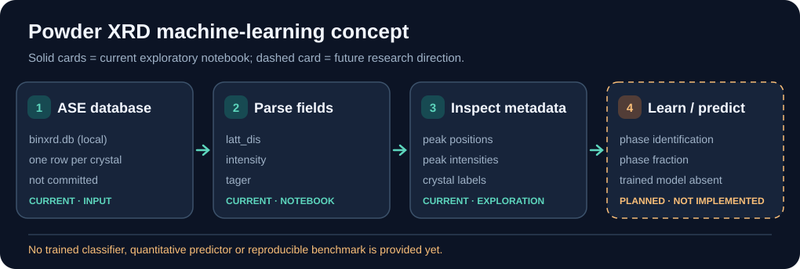

# DiffractoLearn

An early-stage project for machine learning on powder X-ray diffraction (XRD) patterns, with crystal-phase identification and phase-fraction estimation as longer-term goals. What the repository currently contains (2026-10-23):

- `main.py` and `scripts/main.py`: placeholder entry points that only print a greeting.
- `notebooks/test.ipynb`: one cell that reads a local ASE database `binxrd.db` (not in the repository) and, per structure, its element list, lattice spacings, peak intensities, space group and crystal system: a powder X-ray diffraction dataset.
- `pyproject.toml`: dependencies for planned machine-learning work (PyTorch from the CUDA 12.6 index, scikit-learn, ase, refnx, hydra-core, mlcroissant) and no package code yet.

X-ray reflectivity (XRR) fitting is out of scope and is developed separately in [ReflectoLearn](https://github.com/NaNIsaac/ReflectoLearn). The current notebook is exploratory; there is not yet a trained powder-XRD classifier or phase-fraction predictor.

## Current versus planned workflow

The project currently parses an externally supplied diffraction database; training and phase quantification are goals, not shipped features.

To understand the present code, open `notebooks/test.ipynb`; it expects a local `binxrd.db`. The model block in this figure is deliberately **planned**, not an implemented pipeline.

## The notebook's data format

`notebooks/test.ipynb` expects `binxrd.db` in the working directory, an [ASE database](https://wiki.fysik.dtu.dk/ase/ase/db/db.html) with one row per crystal structure and three string-valued key-value pairs per row:

| key | content after parsing |
| --- | --- |
| `latt_dis` | list of lattice spacings |
| `intensity` | list of peak intensities |
| `tager` | `(space group number, crystal system)` |

The strings are parsed with `ast.literal_eval`, which accepts Python literals only. An earlier revision used `eval`, which runs any expression stored in a database field; a database from an untrusted source could execute code on the reader's machine. `literal_eval` raises `ValueError` on such a field instead. The database itself is not in the repository, so the notebook has not been run on the real data; it was checked against a synthetic one-row database and a row carrying a hostile expression.
